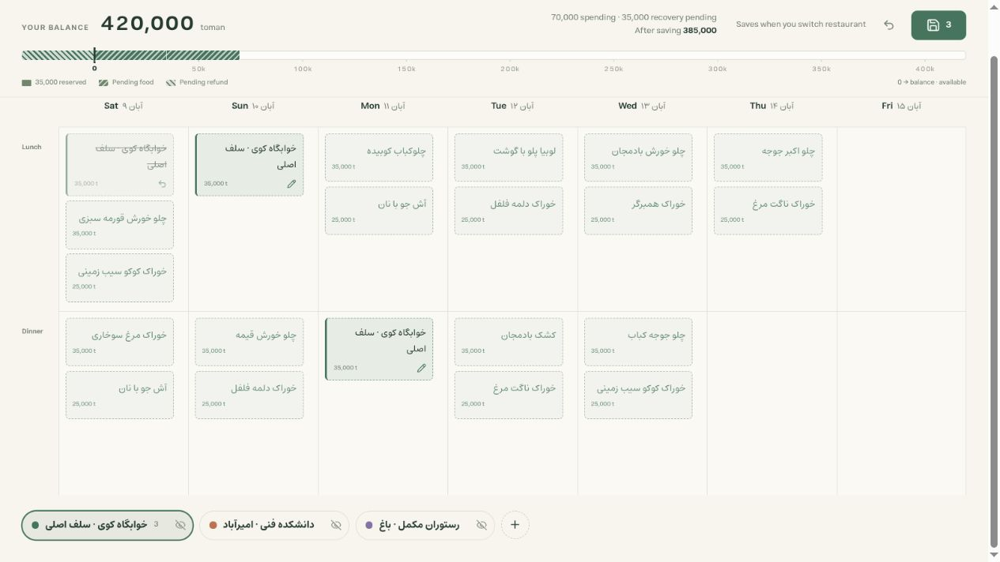

# Loghmeh · لقمه

A calmer meal planner for University of Tehran dining. Pick your usual
restaurants as colors, preview foods inside a weekly calendar, and keep your
choices when the server rejects a request.

Independent, unofficial extension for Firefox / Zen 142+ and Chrome / Chromium 116+.
**Version 0.7.0 · MIT.** Packages are attached to each
[GitHub release](https://github.com/khoda81/loghmeh/releases).



## Use in Zen / Firefox

1. Download the Firefox ZIP from a release and unzip it, or clone this repository
   and run `bun install --frozen-lockfile && bun run build`.
2. Open `about:debugging#/runtime/this-firefox` → **Load Temporary Add-on…**.
3. Select the unzipped `manifest.json` (or `dist/build/manifest.json` from your checkout).
4. Open **Loghmeh** from the browser toolbar. It connects using that browser's
   dining login. If signed out, use **Open dining login**, sign in normally,
   then **Reconnect dining**.
5. Add your usual restaurants from the nested picker. The restaurant pills below the calendar
   size to their full names, wrapping long ones when needed. Food options stay visible;
   click one to select it. Hovering an existing reservation shows ×; clicking the
   card stages its removal; clicking it again keeps the reservation. Keyboard
   focus provides the same actions.

**The extension planner uses real dining data. Submit and changing restaurant
pills submit the outgoing restaurant's pending changes.** Clicking a reservation
stages its cancellation and activates that restaurant for Submit/Undo; other
drafts stay pending. A note beside Submit says when a pill switch would save.
The extension contains the live planner. Sample menus and the separate probe are
available only in the local development preview.

After updating source, run `bun run build` again (or keep `bun run build --watch`
running), click **Reload** in `about:debugging`, then open a new Loghmeh tab. Temporary installation ends when removed or the browser restarts.

If Loghmeh was installed directly from source before the TypeScript migration,
use **Load Temporary Add-on…** again and select
`dist/build/manifest.json`. **Reload** keeps the original installation folder;
it does not switch to the build output. The source folder contains
`background.ts`, not the `background.js` Firefox loads. A “Loading failed for
the module …/background.js” error and an unresponsive toolbar button can mean
the old source folder is still installed.

The only host permission is `https://dining2.ut.ac.ir/*`.
The browser's data-use prompt covers the university session, dining content,
and reservation/wallet requests. [Privacy policy](PRIVACY.md).

## Use in Chrome / Chromium

1. Download the Chrome ZIP from a release and unzip it, or run `bun run package`
   and use `dist/chrome/`.
2. Open `chrome://extensions`, turn on **Developer mode**, and choose
   **Load unpacked** with that folder.
3. Open **Loghmeh** from the extensions menu. The rest works as in Firefox.

Chrome parses dining pages in a hidden offscreen document because its
background service worker has no HTML parser; this adds the `offscreen`
permission. The Chrome build is verified against fictional dining responses
only; a real signed-in session has not yet been checked in Chrome.

## What it does

- View one Saturday-first week, with previous/next controls, Jalali and
  Gregorian dates, and today's column highlighted in Asia/Tehran. The current
  meal gets a stronger border and a Now label (lunch before 16:00, dinner after;
  this is a clock cue, not a serving-window guarantee). Your last viewed week
  is remembered locally, separately for live and sample mode. Only that week is requested for
  selected restaurants; menus arrive incrementally beside their loading pills.
  Loading and queued pills are disabled, with a larger steam indicator; calendar
  cells stay blank until the menu arrives. The eye control hides a restaurant
  from the calendar; it does not cancel its reservations.
  Returning to a loaded week reuses its snapshot in the open tab. The calendar
  has a fixed height; each meal cell scrolls independently. The page scrolls
  naturally with the budget pinned at the top and restaurant pills below the calendar.
- Use the side arrows or Left/Right arrow keys to change weeks. Shift+scroll over the calendar also changes weeks, once per gesture. Only selected places are checked;
  no other week is scanned in the background.
- See known paid value below zero and available balance above zero on the ruler. Pending
  spending and refunds use opposite hatching. Hover a segment for its food and restaurant. Pending amounts are estimates;
  confirmed balances come from dining. Food segments follow date, meal, place,
  and food order, with pending cancellations hatched in place until confirmed.
  The bar includes known reservations from visited weeks. Amounts use toman.
- Submit by restaurant. A rejected or uncertain request keeps its draft.
  Read-back checks what was actually accepted, including partial success.
- Reuse your normal browser login. Loghmeh does not ask for passwords, export
  cookies, register a new SSO client, or run a backend server.

Live writes currently support ordinary single-portion foods and one wallet.
Extras, diet controls, multiple portions, and multiple-wallet spending need
further support; unsupported changes stay disabled. Use one dining interface
at a time because the university API shares a week cursor.

Live restaurant preferences and the viewed week stay local. Real menu snapshots, balances, account
identifiers, and drafts are not persisted. Keep the planner tab open to retain
pending choices; it warns before closing with a draft. The **Report** button
provides diagnostics without passwords, cookies, balances, food names, or
account identifiers.

## Verification status

The original session/menu probe was verified in the user's Zen setup. The new
live parser was checked against freshly loaded authenticated current/next-week
responses on 2026-10-22, including existing reservations and lock/quantity data.
**The 0.4.0 planner's live reads are verified in Zen:** 46 restaurants discovered,
current/next-week menus loaded, and four existing reservations recognized.
The user also verified one intended real change through Loghmeh, with
read-back confirming it. [Sanitized write report](docs/verification/zen-write-2026-10-22.json).
Version 0.4.1 adds automatic recovery of a lost background connection handle.
The real change was made by the user in Zen. No disposable reservation was
created by the implementation tests.

Version 0.5.0's single-week navigation, incremental loading, cached return,
active-week refresh, and chronological balance hatches were checked in the
browser against fictional HTTP responses. [UI verification notes](docs/verification/ui-0.5.0.md).
Version 0.6.0 removes the calendar instructions, coverage summary, slogan, and
footer notices. Reservation cards are direct removal buttons; food options stay
visible in the empty painting space. Fixed calendar rows fill the remaining
viewport and each cell scrolls independently. Slots with no foods stay blank.
The cross-restaurant cancellation flow was checked in the browser's HTTP fixture
and a dedicated controller test. [Calendar verification notes](docs/verification/ui-0.6.0.md).

Version 0.7.0 moves the UI to Svelte 5 and TypeScript, built locally with Vite.
The calendar has a fixed height, a sticky budget, restaurant pills below it,
remembered weeks, and directional navigation animations. Use the side gutters,
Left/Right keys, or Shift+scroll to change weeks. Compact actions and reservation
states use Lucide icons with tooltips. These interactions were checked against
fictional menus, including locked reservations and a failed menu request.

There are 100 passing Bun tests and 20 passing browser parser checks. The
write serializer and reconciliation logic are tested with fictional HTTP
responses; one live change is verified. General refund behavior and batch
atomicity remain unverified. See
[live API notes](docs/live-api.md) and the earlier
[probe verification record](docs/verification.md).

## Develop and preview

The editable source lives in `src/`, with TypeScript and a Svelte 5 UI. Vite
builds the loadable extension into `dist/build/`; load its manifest in Firefox.
Bun 1.4.2 or newer runs the build, tests, type checks, preview server, and ZIP
packager. CI uses the version pinned in `packageManager`. Install the development
dependencies from the committed Bun lockfile:

```sh
bun install --frozen-lockfile
bun test
bun run check     # svelte-check, TypeScript, and manifest checks
bun run preview   # builds dist/preview/ and serves it on port 4173
bun run dev       # Vite dev server with hot reload, same URLs, no extension CSP
```

Node and Python installations are not required.

Open <http://localhost:4173/src/planner.html>. **The local preview uses
fictional data and cannot reuse your dining login.** Sample state stays local to
the preview. Release builds exclude sample menus, simulation controls, and the
probe page; adding `?demo=1` to the extension URL does not enable a sample mode.

Useful local checks:

- `/tests/browser.html` — DOM parser checks.
- `/tests/browser-live-planner.html` — the live client/background/parser stack
  with fictional HTTP responses; no university requests. Add `?reject=1` to
  exercise business rejection.
- Add `?connection=redirect`, `login`, `network`, `permission`, `read-only`, or
  `expired` to that fixture to inspect connection recovery. `expired` fails on
  Refresh after a successful initial connection. In these fixtures, Open dining
  simulates the visit locally; the next check succeeds without opening a real site.
- Add `?menu-error=1` to inspect a failed weekly menu load, its error banner,
  and the restaurant retry state.
- Add `?save-reply=lost` to simulate a saved reservation with a lost extension
  reply. `?save-reply=unavailable` also fails the first read-back connection,
  showing the unverified state and the read-only **Check save status** action.
- `/tests/browser-mobile.html` — 390px responsive preview.
- `/src/probe.html` — the separate read-only development probe. The shipped
  planner's Report button provides connection diagnostics.

`bun run package` builds `dist/loghmeh-0.7.0-firefox.zip` and
`dist/loghmeh-0.7.0-chrome.zip`, plus unpacked `dist/firefox/` and `dist/chrome/`.
Estedad is bundled locally for Persian and Latin text, including its variable weights.
Typography needs no public internet access; live dining only needs access to the
university service. The font's OFL license is included in the third-party notices.

Connection checks distinguish redirects from confirmed sign-in failures and
network errors. After you explicitly open dining from Loghmeh, returning to the
planner checks once automatically. Checks never automatically submit reservations.

The connection card uses the local Saffron Orbit motion study: grains orbit
while checking, form an arch when user action is needed, and settle beside an
empty bowl after a failure. A verified session pours rice into the bowl; the
planner is usable during this brief confirmation. Limited access keeps its
explanation visible. Pause freezes the illustration, reduced motion uses
composed stills, and hidden or offscreen drawings stop rendering. Waiting and
failure states settle without continuous loops. No animation performs a
connection check or changes a reservation.

Failed menu loads, saves, connection attempts, and edits show the full message in
a dismissible error banner. Its bar fills over 12–24 seconds before dismissing;
the timer pauses while hovered, focused, behind a dialog, or in a hidden tab.
Additional errors wait their turn. Dismissing the banner keeps the restaurant's
error/retry state; the browser console also keeps the message and error code.

A lost save reply does not mean the reservation failed. Loghmeh makes one
read-only recovery attempt, checks the same account, and adopts the reservations
and balance returned by dining. If verification is unavailable, it keeps the
submitted intent as **unverified** and labels the balance as last known. Submit
and the restaurant retry control become **Check save status**, which reads state
without resubmitting changes. Edits made during the save are retained. Once a
fresh read identifies unapplied changes, a separate explicit submission can
send the remaining draft.

Packages contain the unminified build, the MIT license, and bundled-library notices; Chrome gets a derived
manifest. `dist/loghmeh-0.7.0-source.zip` holds the sources that addons.mozilla.org
reviews alongside a bundled add-on. Releases are cut from version tags: see [releasing](docs/releasing.md). Captures, outputs, private checks,
and local credentials are ignored and excluded.

The background script owns navigation, preflight, writes, and read-back in a
single queue. The UI owns confirmed state separately from draft intent and
in-flight revisions. Details: [live integration](docs/live-api.md) and
[prototype design](docs/planner-prototype.md).

## License

[MIT](LICENSE). This project is not affiliated with the University of Tehran.

Planner action icons use [Lucide for Svelte](https://lucide.dev/guide/svelte) (`@lucide/svelte`).
Import the icons you need directly in a Svelte component; they are bundled locally with the extension.
Compact actions and reservation states use icons with hover tooltips and accessible labels.
